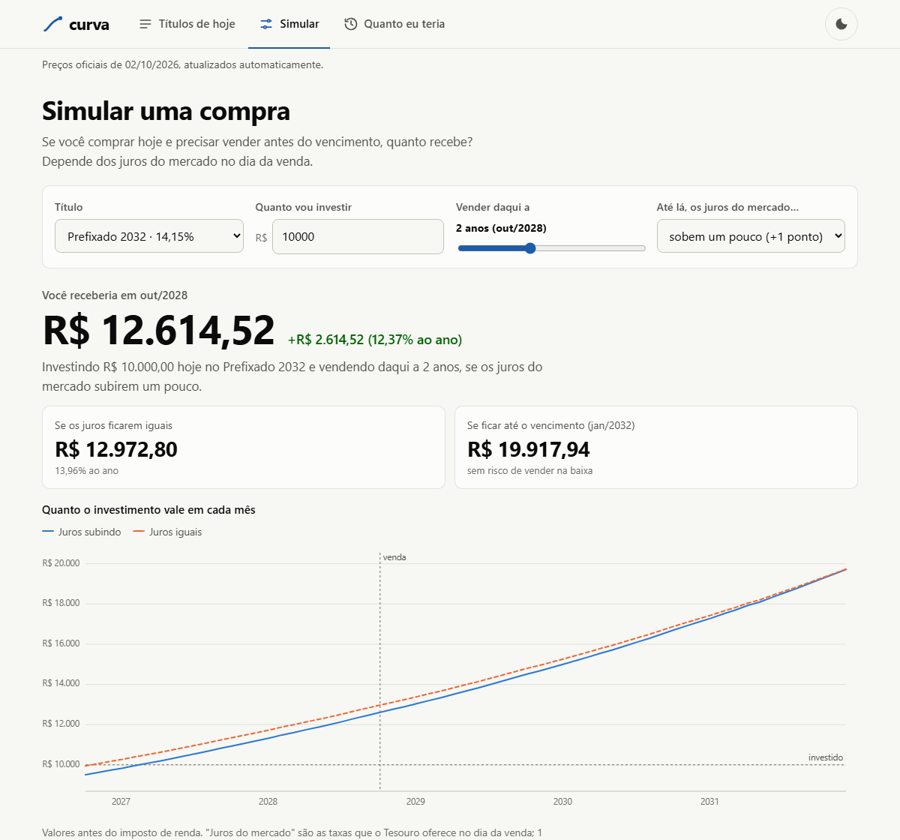

# curva

**Tesouro Direto com os dados oficiais de hoje.** Curva de juros, preços e simuladores
de todos os títulos, atualizados sozinhos todo dia útil a partir dos dados abertos do
Tesouro Nacional. Não usa servidor, chave de API nem banco de dados.

**Site:** https://th3usbit.github.io/curva/



## O que tem no site

| Aba | Para quê |
|---|---|
| **Títulos de hoje** | Quanto cada título rende por ano, quanto custa e quando vence. Escolha um para ver como o preço mudou. |
| **Simular** | "Se eu comprar hoje e vender daqui a 2 anos, quanto recebo?" Depende de os juros subirem, caírem ou ficarem iguais até lá. |
| **Quanto eu teria** | "Se eu tivesse comprado em 2023, quanto teria hoje?" Com os preços oficiais de cada dia, já descontando imposto e taxa da B3, comparado com o Tesouro Selic e a inflação. |

No celular as abas ficam numa barra fixa embaixo, na zona do polegar. No computador ficam no topo.
A conta por trás está em [Como os números são calculados](https://th3usbit.github.io/curva/#metodologia).

## Como fica no ar sem servidor

```
GitHub Actions (6x por dia)                          GitHub Pages
────────────────────────────────────────            ─────────────────────────
baixa o CSV do Tesouro (15 MB, desde 2004)
roda os testes
calcula liquidação, VNA, curvas, fluxos    ──────►  site estático: HTML, CSS,
grava site/dados/*.json                             JS puro e os JSON do dia
publica
```

- **Python, só biblioteca padrão**: nenhum `pip install` para construir o site.
- **JavaScript puro**, sem framework nem biblioteca de gráficos. Os gráficos são SVG próprios, com modo escuro, teclado e tabela acessível.
- Se o download falhar ou o modelo não fechar com os preços do dia, a publicação para e o site anterior continua no ar. A página avisa quando os preços passam de 6 dias.

## O modelo, validado contra o histórico inteiro

Todo título é um conjunto de pagamentos futuros descontados pela taxa do dia, em dias
úteis (base 252). Para os indexados, o valor corrigido (VNA) não vem no arquivo e é
**deduzido dos próprios preços**: todos os títulos do mesmo índice no mesmo dia têm de
concordar sobre ele. O modelo é testado contra os 176.844 preços oficiais desde 2004:

| Título | Preços | Erro mediano | Até 1 centavo | Até 10 centavos |
|---|---:|---:|---:|---:|
| Tesouro Prefixado | 28.145 | R$ 0,005 | 100,0% | 100,0% |
| Tesouro Prefixado com Juros Semestrais | 27.281 | R$ 0,005 | 99,8% | 99,8% |
| Tesouro IPCA+ | 18.889 | R$ 0,003 | 98,9% | 99,9% |
| Tesouro IPCA+ com Juros Semestrais | 44.036 | R$ 0,003 | 97,6% | 99,9% |
| Tesouro Renda+ Aposentadoria Extra | 7.344 | R$ 0,006 | 90,0% | 100,0% |
| Tesouro Educa+ | 13.939 | R$ 0,003 | 99,6% | 100,0% |
| Tesouro IGPM+ com Juros Semestrais | 15.794 | R$ 0,002 | 96,0% | 96,9% |
| Tesouro Selic | 21.416 | R$ 0,003 | 71,8% | 74,5% |

O Tesouro Selic fica atrás porque a taxa é publicada com duas casas, e esse arredondamento
explica o erro restante. Os outros casos estão em [Como os números são calculados](https://th3usbit.github.io/curva/#metodologia).

### O que os dados revelaram

Nada disso está documentado no arquivo. Tudo foi descoberto porque o modelo não fechava:

- **O calendário muda com a lei.** O 20 de novembro virou feriado nacional (Lei 14.759,
  dez/2023). Até 22/12/2023 o Tesouro contava esse dia como útil em todos os anos,
  inclusive nos futuros. Desde 26/12/2023, não. Com o calendário atual, os preços de
  2022–2023 erravam R$ 0,35 e o prazo sobrava 1, 2 ou 4 dias úteis, um por 20/11 até o vencimento.
- **A venda passou a liquidar em D+0 em 13/09/2021.** A compra continua em D+1.
- **A liquidação segue a B3, não o calendário nacional.** Vésperas de Natal e Ano-Novo,
  feriados de São Paulo e jogos do Brasil na Copa de 2014 empurraram a liquidação em um
  dia. O modelo descobre a liquidação de cada dia a partir dos prefixados, que não
  dependem de índice.

## Rodando localmente

```bash
python scripts/construir.py            # baixa o arquivo do Tesouro e gera site/dados/
python -m http.server -d site 8000     # abra http://localhost:8000
```

Sem internet: `python scripts/construir.py --arquivo tests/fixtures/amostra.csv`.

## Testes

```bash
pip install pytest && python -m pytest   # Python: calendário, títulos, modelo contra preços reais
npm test                                 # JavaScript: preços, simulador, impostos, formatação
```

Os testes rodam sobre `tests/fixtures/amostra.csv`, dez dias reais do arquivo do Tesouro
escolhidos para passar por todos os regimes acima. Os testes em JavaScript conferem que a
conta do navegador reproduz os preços oficiais e bate com a do Python.

## Estrutura

```
curva/              Python: calendário, títulos, leitura do CSV, modelo, geração dos JSON
scripts/            construir.py (o que o Actions roda) e fixture_js.py
site/               o site estático (index.html, css/, js/)
tests/              pytest + node --test, com a amostra de preços oficiais
.github/workflows/  publicação diária no Pages e CI
```

## Aviso

Projeto educativo. Não é recomendação de investimento. Dados: Tesouro Nacional,
[Taxas dos Títulos Ofertados pelo Tesouro Direto](https://www.tesourotransparente.gov.br/ckan/dataset/taxas-dos-titulos-ofertados-pelo-tesouro-direto) (dados abertos).

Licença MIT.
